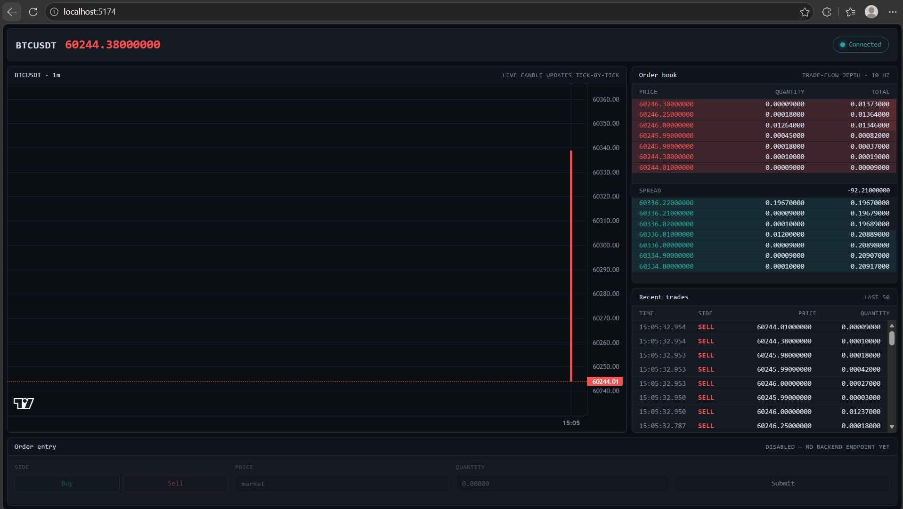

# Real-Time Crypto Trading Terminal

**Java 21 · Spring Boot 3.5 · Kafka (KRaft) · React 18 · TypeScript · Vite**

A Binance-futures-style trading terminal: live candlesticks, a real L2 order book and a
trade tape on the read side, and a persisted, event-driven order path on the write side.
Every number that crosses a boundary is a decimal string — no `float`, no `double`, at any
layer.



> Drop your screenshot at `docs/screenshot.png` and it renders here.

---

## Table of contents

- [Architecture](#architecture)
- [Key technical achievements](#key-technical-achievements)
- [Kafka topology](#kafka-topology)
- [Getting started](#getting-started)
- [Configuration](#configuration)
- [Observability](#observability)
- [Testing](#testing)
- [Project structure](#project-structure)

---

## Architecture

### Read path — market data

```
                    ┌──────────────────────────────────────────────┐
  Binance combined  │              ingestion (Reactor)             │
  WebSocket         │  wss://stream.binance.com:9443/stream        │
  stream?streams=   │    ?streams=btcusdt@aggTrade                 │
    btcusdt@aggTrade│             /btcusdt@depth20@100ms           │
    btcusdt@depth20 │                                              │
        │           │  receive() → publishOn(boundedElastic)       │
        └──────────▶│           → dispatch on stream name          │
                    └───────┬───────────────────────┬──────────────┘
                            │ TradeEvent            │ DepthEvent
                            ▼                       ▼
                  ┌───────────────────┐   ┌───────────────────┐
                  │ binance-raw-trades│   │   binance-depth   │
                  │  (6 partitions,   │   │  (6 partitions,   │
                  │   key = symbol)   │   │   key = symbol)   │
                  └─────┬───────┬─────┘   └─────────┬─────────┘
                        │       │                   │
        ┌───────────────┘       └────────┐          │
        ▼                                ▼          ▼
┌──────────────────┐         ┌────────────────┐  ┌─────────────────────┐
│ TradeAggregator  │         │ TradeDelivery  │  │ DepthKafkaConsumer  │
│ 1m OHLCV candles │         │ lock-free ring │  │ latest frame/symbol │
│ late-trade fixup │         │ buffer (50)    │  │                     │
└────────┬─────────┘         └───────┬────────┘  └──────────┬──────────┘
         │ binance-klines-1m         │                      │
         ▼                           │                      │ 10 Hz sample
┌──────────────────────┐             │                      ▼
│ CandleKafkaConsumer  │             │           ┌──────────────────────┐
└──────────┬───────────┘             │           │ OrderBookBroadcaster │
           │                         │           │ cumulative totals    │
           │                         │           └──────────┬───────────┘
           └────────────┬────────────┴──────────────────────┘
                        ▼
              ┌──────────────────────┐
              │  STOMP /ws-trades    │  /topic/trades   /topic/klines
              │  (SockJS, heartbeat) │  /topic/klines/live
              └──────────┬───────────┘  /topic/orderbook
                         ▼
              ┌──────────────────────┐
              │ React 18 + Zustand   │  20 Hz batched flush → 60 FPS canvas
              │ lightweight-charts   │  react-window virtualisation
              └──────────────────────┘
```

### Write path — CQRS

```
  React ticket ──POST /api/orders──▶ OrderController (@Valid)
                                          │
                                          ▼
                                    OrderService
                                   @Transactional
                                          │  1. INSERT orders (UUID, NUMERIC(38,18))
                                          │  2. publishEvent(OrderPlacedEvent)
                                          ▼
                            @TransactionalEventListener(AFTER_COMMIT)
                                          │
                                          ▼
                                  Kafka  order-events
                                          │  (key = symbol)
                                          ▼
                      OrderKafkaConsumer ─┴─▶ STOMP /topic/orders
                                                  │
                                                  ▼
                                        "Order confirmed via WS: <id>"
```

The command side answers *"was this accepted?"* and owns truth about intent. The query
side answers *"what does the market look like?"* and owns no state that matters — every
read model is rebuilt from an in-memory cache or the log.

---

## Key technical achievements

### Lock-free ring buffer for instant snapshots
`TradeRingBuffer` keeps the last 50 trades for new subscribers using an `AtomicLong`
sequence and an `AtomicReferenceArray` of immutable slots — no `synchronized`, no lock, no
copy on write. A reader validates its sequence number and retries if a slot was recycled
mid-read, so a joining client gets a consistent snapshot without ever blocking the writer.

### Backpressure that protects the event loop
`KafkaTemplate.send()` can block for `max.block.ms` while it fetches metadata or waits for
send-buffer space. Doing that on a `reactor-http-nio-*` thread stalls every socket
multiplexed onto it. The ingestion pipeline therefore hops once:

```java
session.receive()
    .map(WebSocketMessage::getPayloadAsText)
    .timeout(idleTimeout)                       // a silent socket is a dead socket
    .publishOn(ingestScheduler, prefetch)       // ← boundedElastic, the only hop
    .doOnNext(this::dispatch)                   // JSON binding + Kafka send happen here
    .then()
```

Reconnects use `Retry.backoff(1s → 30s, jitter 0.5)` and a clean close is mapped to an
error so one retry ladder covers both cases.

### CQRS with `@TransactionalEventListener`
Publishing inside `@Transactional` can announce an order that subsequently rolls back — a
phantom order downstream consumers would act on. The event is published in `AFTER_COMMIT`,
so a rolled-back transaction produces no Kafka record at all. The residual dual-write
window (commit succeeds, publish fails) is documented; the real fix is a transactional
outbox.

### Real L2 order book, not a proxy
`@depth20@100ms` from the exchange, throttled to a 10 Hz broadcast. Cumulative `total` is
computed server-side in `BigDecimal`, both sides are re-sorted defensively, and malformed
levels are skipped individually rather than discarding a snapshot. The spread is exact
decimal subtraction.

### Zustand throttling for 60 FPS
Ingest handlers only append to module-scope buffers; a 50 ms interval (`20 Hz`) detaches
the buffers and commits them in one `set()`. Socket rate never becomes render rate. At
200 trades/s the chart still repaints once per flush, and an idle socket causes zero
re-renders because `flush()` returns before touching state.

### Typed Kafka consumers, without type headers on the wire
`spring.json.value.default.type` is pinned to `TradeEvent`, so the trade topic needs no
type headers (`~30 B` saved per record). Topics whose payload is a different shape get an
explicit `ContainerFactory` (`TypedListenerConfig`) built **inside** the bean method —
contributing a `ConsumerFactory` bean of their own would silently suppress Boot's
`@ConditionalOnMissingBean` factory and break every other listener.

---

## Kafka topology

| Topic | Payload | Key | Producer | Consumer group |
|---|---|---|---|---|
| `binance-raw-trades` | `TradeEvent` | symbol | ingestion | `terminal-delivery-group`, `terminal-aggregator-group` |
| `binance-raw-trades.DLT` | raw bytes | — | error handler | — |
| `binance-klines-1m` | `CandleEvent` | symbol | `TradeAggregator` | `terminal-candle-delivery-group` |
| `binance-depth` | `DepthEvent` | symbol | ingestion | `terminal-depth-group` |
| `order-events` | `OrderPlacedEvent` | symbol | `OrderService` | `terminal-order-events-group` |

6 partitions each, RF = 1 (single broker). Every topic is keyed by symbol, so all records
for one symbol land on one partition and per-symbol ordering is guaranteed by the broker
rather than by application code.

---

## Getting started

**Prerequisites:** JDK 21, Maven 3.9+, Node 20+, Docker.

```bash
# 1. Infrastructure: Kafka 4.3.1 (KRaft) + Postgres 17
docker compose up -d

# 2. Backend (runs Flyway migration, declares topics, opens the WebSocket)
mvn spring-boot:run

# 3. Frontend
cd trading-terminal-frontend
npm install
npm run dev
```

Open <http://localhost:5173>. The Vite dev proxy forwards `/api/**` and `/ws-trades/**` to
Spring on `:8080`, so there is no CORS configuration anywhere.

**Verify it is alive:**

```bash
curl -s localhost:8080/actuator/health
curl -s localhost:8080/actuator/metrics/terminal.ingestion.frames.received
curl -s localhost:8080/actuator/metrics/terminal.orderbook.snapshots.broadcast
```

**Place an order:**

```bash
curl -i -X POST localhost:8080/api/orders \
  -H 'Content-Type: application/json' \
  -d '{"symbol":"BTCUSDT","side":"BUY","price":"60000.00","quantity":"0.01"}'
# 201 Created + Location: /api/orders/<uuid>

docker exec terminal-postgres psql -U trader -d trading \
  -c "SELECT id, side, price, quantity, status FROM orders ORDER BY created_at DESC LIMIT 5;"

docker exec terminal-kafka /opt/kafka/bin/kafka-console-consumer.sh \
  --bootstrap-server localhost:9092 --topic order-events --from-beginning --max-messages 1
```

---

## Configuration

Everything is env-overridable in `src/main/resources/application.yml`.

| Variable | Default | Purpose |
|---|---|---|
| `BINANCE_WS_URL` | spot combined stream, `aggTrade` + `depth20@100ms` | upstream feed |
| `ORDERBOOK_DEPTH` | `20` | levels per side |
| `ORDERBOOK_BROADCAST_MS` | `100` | book fan-out interval (10 Hz) |
| `ORDERBOOK_DEPTH_BPS` | — | reserved |
| `AGGREGATION_LATE_TOLERANCE` | `5s` | how late a trade may still correct a closed candle |
| `POSTGRES_USER` / `POSTGRES_PASSWORD` | `trader` / `trader_dev_pw` | database |
| `FLYWAY_ENABLED` | `true` | run migrations at startup |
| `ORDER_EVENT_DESTINATION` | `/topic/orders` | order confirmations |

Postgres is exposed on host port **5433**, Kafka on **9092**.

---

## Observability

Micrometer counters trace every hop, which is how the pipeline is debugged rather than
guessed at:

```
terminal.ingestion.frames.received          raw WebSocket frames
terminal.ingestion.trades.parsed            decoded TradeEvent
terminal.ingestion.trades.published         broker-acked trades
terminal.ingestion.trades.failed            dropped publishes
terminal.ingestion.depth.parsed             decoded DepthEvent
terminal.aggregation.candles.published      closed 1m candles
terminal.aggregation.late.corrected|dropped late-trade handling
terminal.delivery.trades.broadcast          STOMP fan-out (trades)
terminal.delivery.candles.broadcast         STOMP fan-out (candles)
terminal.delivery.snapshot.size             ring buffer occupancy
terminal.orderbook.depth.received           depth frames consumed
terminal.orderbook.snapshots.broadcast      book frames sent to clients
```

A funnel that stops advancing tells you exactly which hop is broken: `frames.received`
flat means the upstream is silent; `parsed` climbing while `published` does not means the
broker is unreachable.

---

## Testing

```bash
mvn test                                  # 10 tests
cd trading-terminal-frontend && npx tsc -b && npm run build
```

Unit tests cover the parts where a bug is silent rather than loud: candle aggregation
(late trades, rollover) and depth mapping (cumulative totals, defensive sorting, malformed
rows, depth truncation). The order-book tests exist because a first implementation of
pruning passed review and failed its test — a stale level above the market produced a
negative spread.

---

## Project structure

```
src/main/java/com/terminal/
├── ingestion/      Binance WebSocket → Kafka (Reactor, dual-stream dispatch)
├── aggregation/    1m OHLCV candles, late-trade correction
├── delivery/       Kafka → STOMP, lock-free ring buffer for snapshots
├── orderbook/      depth consumer, snapshot mapping, 10 Hz broadcaster
├── orders/         CQRS write side: entity, service, REST, event consumer
└── config/         typed properties, schedulers, consumer factories

trading-terminal-frontend/src/
├── components/     CandleChart, OrderBook, TradeFeed, OrderEntry, TopBar
├── store/          Zustand + 20 Hz flush loop
├── services/       STOMP transport (wsService) and store bridge (tradeStream)
└── utils/          decimal formatters, placeholder history generator
```

---

## License

MIT
